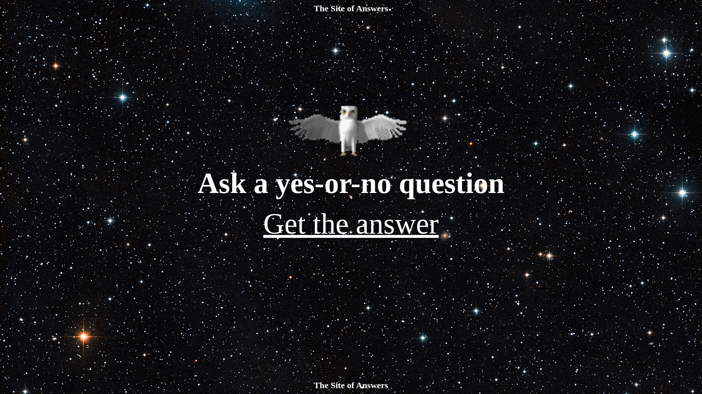

# The Site of Answers 🔮🧙‍♂️🌙
## Personal Project

Inspired by _The Book of Answers_, this website offers quick guidance in the simplest form. Ask a yes-or-no question, and it answers with a simple **Yes** or **No**.

[the-site-of-answers.pages.dev](https://the-site-of-answers.pages.dev/)

Have fun with the answers, but don’t blame me if you don’t like them.

## Stars

